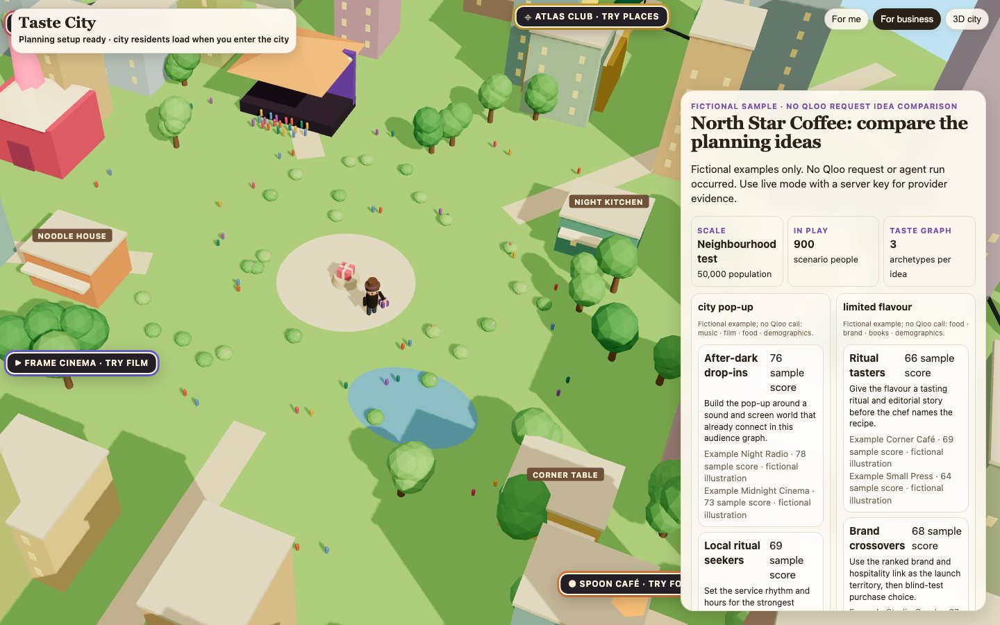

# Taste City

**Test a business idea against real audience taste before you spend money on it.** A coffee-shop owner or festival programmer picks the tastes their customers share, compares two ideas, and gets a next-action brief. Every cultural link in it is a relationship Qloo returned, with the entity and the call you can check.

[Open Taste City](https://taste-city.vercel.app/?setup=1) · [Try the fictional no-key sample](https://taste-city.vercel.app/?demo=1&setup=1)



## The pitch

**The problem.** Ask an AI model with no audience context what a London coffee pop-up should do, and you get the classic answer: single-origin beans, pour-over, limited seating. Give it Qloo taste profiles for the audience and you get Yves Tumor listening sessions and Synecdoche, New York in the decor. A small business needs the second kind of answer, and it needs to know where each suggestion came from before it spends on it.

**Who it is for.** Coffee-shop owners and festival programmers testing an idea, and anyone who wants to explore their own taste.

**What it does.**

- **For business:** pick audience tastes, a city and two ideas, such as a pop-up versus a new flavour. Taste City compares them through the Qloo taste graph and hands back a next-action brief with a budget cap and a stop rule.
- **Live Taste Agent:** it does the research itself. It picks its strongest cultural lead, uses the returned Qloo entity ID to query a second domain, checks the result and proposes a small field test. On the live site it followed Synecdoche, New York into music and came back with Pixies, in 8 Qloo reads against a hard cap of 11.
- **For me:** pick three favourites and a city. Qloo returns five discoveries across music, film, food, books and places, each naming the entity and the call it came from.
- **The city:** residents, cultural outlets, a gift game, a subway, a festival and a day/night cycle.

**Why Qloo.** Taste does not stay in one category: the music you love connects to the films, books, food and places you will love next. Qloo returns those cross-domain relationships as real entities with call references. A language model alone cannot give you that trail.

**What we measured, and against what.**

- Blind test, 24 Oct: five frozen business questions, a rubric written before any output existed, and a grader from a different model family that never knew which answer used Qloo. Against the same model (Claude Haiku 4.5) with no audience context, answers built on Qloo taste profiles scored 25 versus 19 on specificity and won 4 of the 5 questions, tying the fifth.
- Frontier check, 29 Oct: against two frontier models given the same audience description without the Qloo facts, Qloo made no measurable difference to answer quality (Claude Opus 5.5 +1.3%, Codex gpt-6.1-sol -3.7%, inside grader noise). The value here is not nicer prose. It is that every cultural link is real, specific and checkable.

**What is next.** Put the briefs in front of real coffee-shop owners and festival programmers and measure which Qloo references they act on.

## Judge path

1. Open the fictional sample. Choose **For a coffee shop: test** to compare ideas, or **For me: discover** to explore tastes. Sample results are invented; they do not prove a live Qloo request or customer demand.
2. For a live run, return to the app without `demo=1`. Qloo access must be configured on the server. A live request uses Qloo quota; the Taste Agent does not need an LLM key. Inspect the source-call/entity trail and the conditions that should drop an idea.
3. To reproduce without API access, clone the public source and follow the sample setup and tests below. Tests use synthetic providers, so passing them establishes implementation behavior, not Qloo superiority or real audience preference.
4. Business spending and feasibility inputs are planner assumptions. Cultural affinity, demand and sales are different claims; do not read a fit score as a demand forecast.

- **For a coffee shop: test** is the main route. A coffee-shop owner sets three tastes they think their customers share and compares two ideas, such as a pop-up or a late event, against a taste graph. Cultural fit and the planner's spending assumptions stay separate. Save and reopen a local action brief with a budget and feasibility checks. A festival planner can use the same flow.
- **Live Taste Agent** follows one cited cultural lead into another Qloo domain, checks that result and proposes a small test. The card shows the returned entity ID, the follow-up query seeded with it, the result and the conditions that should drop the idea. It uses up to 11 Qloo HTTP reads including retries and needs no model key.
- **For me: discover** takes three favourites and a food city, then finds music, film, food, books and places through Qloo. Each result carries its source call.
- **City and gift game** keeps the Sims-style city, residents, outlets, subway, festival and day/night cycle available from the header.

Qloo affinity describes cultural relationships. It does not predict demand, sales, attendance, conversion or partner availability. The business audience is a planner hypothesis.

## Run locally

Use Python 3.12 and install the dependencies:

```sh
git clone https://github.com/Morkeeth/taste-city.git
cd taste-city
python3.12 -m venv .venv
. .venv/bin/activate
pip install -r requirements.txt
python3 match_app.py
```

Open http://127.0.0.1:8811/?demo=1&setup=1 for the two starting paths with fictional sample data. The sample makes no Qloo or model call. Its default discovery tastes and city are fixed; arbitrary tastes need live Qloo.

For live discovery, business comparisons, the live agent and city population, set `QLOO_API_KEY` in the server process, then open http://127.0.0.1:8811/. Keys stay on the server. Supply them through your environment or hosting secret store, never client code or source control.

The optional Matchmaker needs `ANTHROPIC_API_KEY`. Persistent legacy pair links need `KV_REST_API_URL` and `KV_REST_API_TOKEN`; without Redis, serverless pair links are temporary. The two main starting paths and the live Taste Agent do not require these optional services.

A public brand website can provide visible source cues. Confirm its resolved entity before treating its graph as the brand source; customer tastes remain unmeasured. Confirm or change audience tastes before comparing ideas.

## Verify

```sh
python3 -m unittest
python3 build_static.py
```

Tests use local synthetic providers and make no external Qloo or model call. A test for an optional private recording skips when that recording is absent. Public source contains no provider recordings or runtime cache. Browser capture helpers in `tests/` are optional and require `requirements-dev.txt` plus Playwright; do not run their live modes unless you intend to use API quota.

`build_static.py` copies only browser HTML and the bundled Three.js files into `public/`. `api/` contains the matching Vercel Python handlers. The local server uses those same handlers.

## Host

`vercel.json` configures Python functions, static build output and routes. Set `QLOO_API_KEY` in the production server environment. `deploy.sh` is guarded for the existing `taste-city` project and owner; it checks the link and production key name, builds static assets and runs the suite before deployment. It does not configure credentials.

Qloo data is fetched live into ignored caches; repeated exact business choices can use a visibly labelled recording. Clean source uses fictional sample results only in sample mode. Missing keys and unavailable results remain explicit.

## License and data

MIT; see `LICENSE`. Bundled Three.js retains its license in `vendor/THREE-LICENSE`. Qloo results are service data and are not included in this source release. The city can pair returned public Wikidata references with English Wikipedia pageviews; pageviews measure attention rather than taste.
