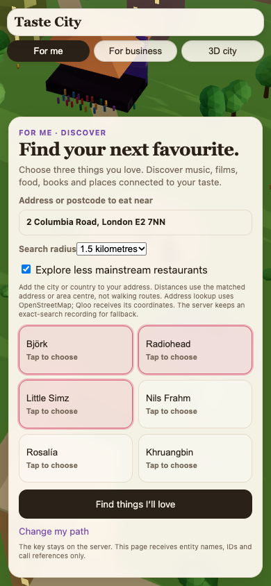
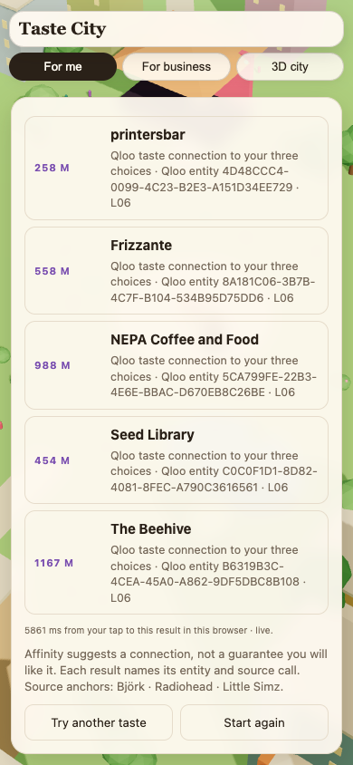
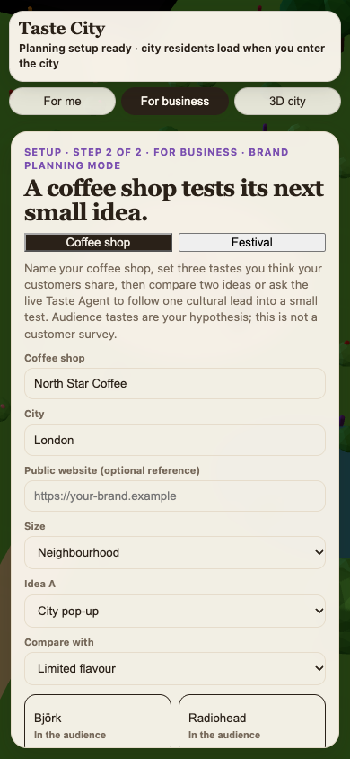
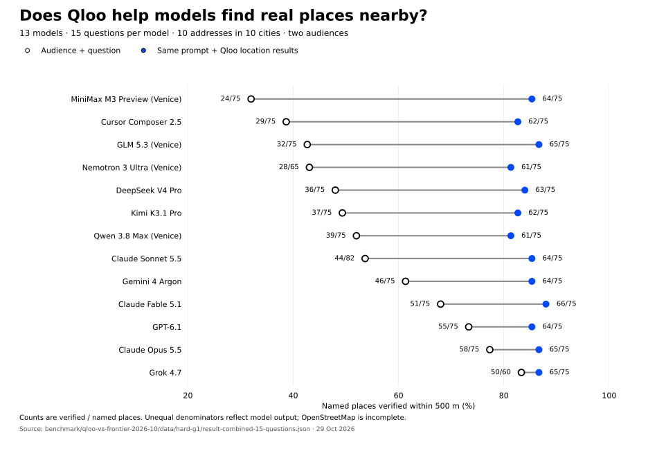

# Taste City

## TLDR

Find music, films, food, books and places connected to three things you love, in a living 3D city.<br>
For a café or festival, turn an audience taste hypothesis into a small experiment with a budget cap and a stop rule.<br>
Qloo supplies checkable cultural links; our 13-model experiment found a benefit for nearby-place discovery, not better advice prose.

[Try Taste City](https://taste-city.vercel.app/?setup=1) · [Watch the 1:53 demo](https://youtu.be/47e_Wt216SI) · [Read the benchmark](benchmark/qloo-vs-frontier-2026-10/) · [No-key sample](https://taste-city.vercel.app/?demo=1&setup=1)

## The problem

A café owner planning a pop-up needs something more useful than “single-origin beans and limited seating.” They need cultural references that relate to their audience, a way to investigate those references, and a small next step before spending money.

Before building, we talked with pop-up shops, cafés and run clubs. Oscar spoke with **3 café owners and 2 bar owners** who have this problem. Those conversations informed the product; they are not evidence of paid adoption or improved business outcomes.

## The pitch

Taste crosses categories. Someone's music can lead to films, books, food and places. Taste City makes those connections explorable and gives a small business a way to test an idea.

- **For me:** choose three favourites, then a city or an address with its city/country. Discover across five domains. Nearby restaurant results show a matched address, straight-line distance, Qloo entity and source call. Choose 500 m, 1 km or 1.5 km; missing or out-of-radius coordinates are rejected.
- **For business:** set an audience taste hypothesis, a city and two ideas, such as a pop-up versus a new flavour. Compare cultural references, then save or download an action brief with a budget cap, feasibility questions and a stop rule.
- **Live Taste Agent:** follow one Qloo-returned cultural lead into a second domain, inspect the follow-up and propose a field test. One hosted check followed *Synecdoche, New York* to Pixies in **8 Qloo reads, within an 11-read cap**. This bounded tool loop makes no language-model call.
- **The city:** explore residents, cultural outlets, a gift game, a subway, a festival and a day/night cycle.

### The actual product

<table>
<tr><th>Choose tastes and an address</th><th>Inspect nearby results</th><th>Plan a business experiment</th></tr>
<tr>
<td></td>
<td></td>
<td></td>
</tr>
</table>

Screens captured from the hosted product on **29 October 2026**. The nearby example uses **1.5 km**, not the benchmark's 500 m. The business screenshot is a setup example with an illustrative shop name, not a customer result. The [demo video](https://youtu.be/47e_Wt216SI) shows the product and labels the research chart separately.

## The experiment: where does Qloo actually help?

We first tried improving business advice with taste context. Under a matched control, that did not improve the prose. We then tested an answer we could check: **name five real places within 500 m of an address**.

With Qloo's location results added to the same audience and question, all **13 models** reached **81–88% of named places verified within 500 m**, versus **32–83% without Qloo**. The experiment used **15 questions per model, 10 addresses in 10 cities and two audiences**. Four models ran on Venice with its system prompt off.



The two-sided sign test over questions is significant at p < 0.05 for **7 of 13** models: GLM, MiniMax, Composer, Sonnet, Kimi, DeepSeek and Nemotron. The other six improved numerically without a significant result at this sample size. These are per-model tests, without a multiple-comparison correction.

**What this measures:** OpenStreetMap can place a named venue within 500 m. It does **not** measure audience fit, preference or commercial success. OpenStreetMap is incomplete; a missing match does not prove that a place was invented. Models sometimes named more or fewer than five places, so denominators differ.

[Full protocol, model names, exact counts, p values, costs, failed approaches and rerun instructions](benchmark/qloo-vs-frontier-2026-10/). The prose-advice rerun scored **−3.5% for Opus and −0.4% for GPT** against the matched audience-only control. The earlier five-question exploratory test scored 25 versus 19 on specificity against a model given no audience context; that weaker comparison is not the basis of the location result.

The [figure script](docs/figures/plot_location_benchmark.py) reads the published counts directly. Regenerate it with `python3 docs/figures/plot_location_benchmark.py` after installing the optional plotting dependency `matplotlib`.

## Try it

1. [Open Taste City](https://taste-city.vercel.app/?setup=1). Choose **For me** for discovery or **For business** for planning.
2. For nearby discovery, supply an address with its city/country, check the matched address and choose a radius. Address lookup uses OpenStreetMap Nominatim; Qloo receives coordinates. Distances are straight-line, not walking routes.
3. For business, keep the coffee-shop defaults and click **Ask live Taste Agent**. Inspect the entity/call trail and the proposed stop rule.
4. Without API access, use the [fictional sample](https://taste-city.vercel.app/?demo=1&setup=1). It makes no provider request. Default sample tastes and city are fixed.

Live requests use Qloo quota. A cultural relationship is not proof of demand, sales, attendance or partner availability. Business spending inputs remain planner assumptions. Next, we need to observe which references owners act on and whether those decisions work.

## Run locally

Requires Python 3.12. The browser uses JavaScript and bundled Three.js; the server is Python.

```sh
git clone https://github.com/Morkeeth/taste-city.git
cd taste-city
python3.12 -m venv .venv
. .venv/bin/activate
pip install -r requirements.txt
python3 match_app.py
```

Open http://127.0.0.1:8811/?demo=1&setup=1 for fictional sample mode. Startup can warn that provider keys are absent; the sample does not need them.

For live discovery, business comparisons, the agent and city population, provide `QLOO_API_KEY` through the server environment or hosting secret store, then open http://127.0.0.1:8811/. Keys stay on the server and out of git. The optional legacy Matchmaker uses `ANTHROPIC_API_KEY`; persistent legacy pair links use `KV_REST_API_URL` and `KV_REST_API_TOKEN`. The main paths do not require those optional services.

## Verify and host

```sh
python3 -m unittest
python3 build_static.py
```

The tests use synthetic providers and make no external model or Qloo call. One optional private-recording test skips when its file is absent. Browser helpers in `tests/` require `requirements-dev.txt` and Playwright; live modes consume quota.

`build_static.py` copies browser HTML and bundled Three.js to `public/`. Vercel's eleven file-based Python functions in `api/` are also used by the local server. Set `QLOO_API_KEY` in production. `deploy.sh` is guarded for the existing project and owner; it checks the link and key name, builds and runs the suite. It does not configure credentials.

Exact-input cached results are visibly labelled recordings. Failed lookup never silently broadens a local search. Runtime provider caches and original Qloo responses stay outside this repository; the benchmark publishes redacted inputs with original hashes.

## For agents

Start with [AGENTS.md](AGENTS.md) for the code map, no-key checks, evidence boundaries and deployment constraints. The [benchmark](benchmark/qloo-vs-frontier-2026-10/) has its own runnable harness and model requirements.

## License and data

Code is MIT; see [LICENSE](LICENSE). Bundled Three.js retains [its license](vendor/THREE-LICENSE). Qloo results are service data, not MIT-licensed by this repository. OpenStreetMap data © OpenStreetMap contributors, ODbL. Public Wikidata references and Wikipedia pageviews can enrich the city; pageviews measure attention, not taste.
